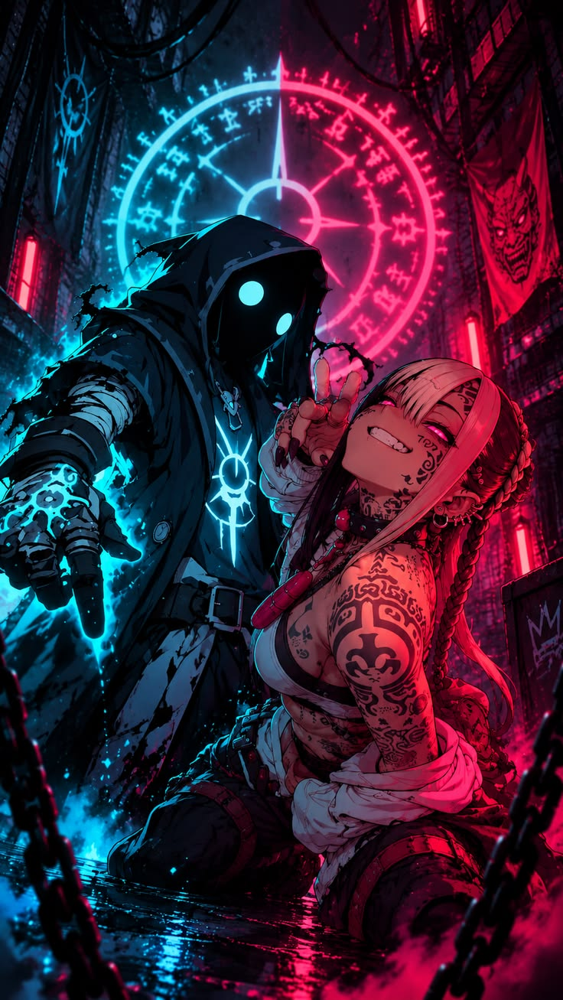

<!DOCTYPE html>
<html lang="es" class="scroll-smooth">
<head>
    <meta charset="UTF-8">
    <meta name="viewport" content="width=device-width, initial-scale=1.0">
    <title>Misael el Alquimista | Blog, Galería, Tienda & Podcast</title>
    
    <!-- Tailwind CSS CDN -->
    
    
    <!-- Google Fonts: Cinzel (Títulos), Inter (Lectura) & Fira Code (Metadatos/Terminal) -->
    <link rel="preconnect" href="https://fonts.googleapis.com">
    <link rel="preconnect" href="https://fonts.gstatic.com" crossorigin>
    <link href="https://fonts.googleapis.com/css2?family=Cinzel:wght@600;700;800&family=Fira+Code:wght@400;500;600&family=Inter:wght@300;400;500;600;700&display=swap" rel="stylesheet">
    
    <!-- FontAwesome para iconos vectoriales -->
    <link rel="stylesheet" href="https://cdnjs.cloudflare.com/ajax/libs/font-awesome/6.5.1/css/all.min.css">

    <!-- Configuración de la Paleta de 7 Colores: Alquimia Carmesí & Obsidiana Nocturna -->
    

    
</head>
<body class="antialiased selection:bg-alchemy-crimson selection:text-white">

    <!-- Notificaciones Toast -->
    

    <!-- Barra de Navegación Fija (Pizarra Nocturna #1E242D) -->
    <nav class="sticky top-0 z-40 bg-alchemy-slate/90 backdrop-blur-md border-b border-alchemy-steel/50">
        

            

                <!-- Marca -->
                <a href="#" class="flex items-center gap-3 group">
                    

                        <i class="fa-solid fa-flask-vial text-alchemy-crimson text-sm"></i>
                    

                    
                        Misael el Alquimista
                    
                </a>

                <!-- Enlaces Desktop -->
                

                    <a href="#blog" class="text-alchemy-mist hover:text-alchemy-pearl transition-colors">Bitácora</a>
                    <a href="#galeria" class="text-alchemy-mist hover:text-alchemy-pearl transition-colors">Galería</a>
                    <a href="#podcast" class="text-alchemy-mist hover:text-alchemy-pearl transition-colors">Podcast</a>
                    <a href="#tienda" class="text-alchemy-mist hover:text-alchemy-pearl transition-colors">Tienda</a>
                    <a href="#redes" class="text-alchemy-mist hover:text-alchemy-pearl transition-colors">Redes</a>
                

                <!-- Botones de Acción (Estudio CMS & Carrito) -->
                

                    <button onclick="toggleStudioModal('post')" class="px-3.5 py-2 rounded-xl bg-alchemy-wine/80 hover:bg-alchemy-ruby border border-alchemy-ruby text-alchemy-pearl text-xs sm:text-sm font-semibold transition-all flex items-center gap-2" title="Abrir Estudio CMS">
                        <i class="fa-solid fa-wand-magic-sparkles text-alchemy-crimson"></i>
                        Estudio [CMS]
                    </button>

                    <button onclick="toggleCartModal()" class="relative p-2.5 rounded-xl bg-alchemy-crimson hover:bg-alchemy-ruby text-white font-bold transition-all shadow-crimson" aria-label="Abrir carrito">
                        <i class="fa-solid fa-bag-shopping"></i>
                        0
                    </button>
                

            

        

        <!-- Sub-navegación móvil -->
        

            <a href="#blog" class="text-alchemy-mist hover:text-alchemy-crimson px-2 py-1">Bitácora</a>
            <a href="#galeria" class="text-alchemy-mist hover:text-alchemy-crimson px-2 py-1">Galería</a>
            <a href="#podcast" class="text-alchemy-mist hover:text-alchemy-crimson px-2 py-1">Podcast</a>
            <a href="#tienda" class="text-alchemy-mist hover:text-alchemy-crimson px-2 py-1">Tienda</a>
            <a href="#redes" class="text-alchemy-mist hover:text-alchemy-crimson px-2 py-1">Redes</a>
        

    </nav>

    <!-- Sección Hero con Venas de Luz Carmesí sobre Obsidiana -->
    <header class="relative overflow-hidden py-16 sm:py-24 border-b border-alchemy-steel/50 obsidian-veins">
        <!-- Filamento carmesí central de fondo -->
        

        

        
        

            <!-- Emblema del Autor -->
            

                
                
                    Alquimia Literaria & Código
                
            

            <h1 class="font-serif text-3xl sm:text-5xl lg:text-6xl font-extrabold text-alchemy-pearl tracking-tight mb-4">
                Misael el Alquimista
            </h1>
            

                Entre la obsidiana silenciosa de la noche y las venas incandescentes del verbo. Bienvenido a mi laboratorio personal de fantasía oscura, prosa poética, ensayos, sátira y frecuencias sonoras.
            

            <!-- Accesos Rápidos Hero -->
            

                <a href="#blog" class="px-6 py-3 rounded-2xl bg-alchemy-crimson hover:bg-alchemy-ruby text-white font-bold transition-all shadow-crimson flex items-center gap-2">
                    <i class="fa-solid fa-feather-pointed"></i> Leer Bitácora
                </a>
                <a href="#tienda" class="px-6 py-3 rounded-2xl bg-alchemy-slate hover:bg-alchemy-wine border border-alchemy-steel hover:border-alchemy-ruby text-alchemy-pearl font-semibold transition-all flex items-center gap-2">
                    <i class="fa-solid fa-gem text-alchemy-crimson"></i> Tienda Alquímica
                </a>
            

        

    </header>

    <!-- Contenido Principal -->
    <main class="max-w-6xl mx-auto px-4 sm:px-6 lg:px-8 py-14 space-y-24">

        <!-- =================================================================
             SECCIÓN 1: BITÁCORA / BLOG DE TEXTOS CON FILTRO DE CATEGORÍAS
        ================================================================== -->
        <section id="blog" class="scroll-mt-24">
            

                

                    // 01. Códice Escrito
                    <h2 class="font-serif text-2xl sm:text-3xl font-bold text-alchemy-pearl mt-1">Bitácora & Textos</h2>
                

                

                    <input type="text" id="search-posts" oninput="renderPosts()" placeholder="Buscar en escritos..." class="px-4 py-2 rounded-xl bg-alchemy-slate border border-alchemy-steel text-sm text-alchemy-pearl placeholder-alchemy-mist/70 focus:outline-none focus:border-alchemy-crimson w-full sm:w-56">
                    <button onclick="toggleStudioModal('post')" class="px-4 py-2 rounded-xl bg-alchemy-crimson hover:bg-alchemy-ruby text-white text-xs sm:text-sm font-bold transition-colors whitespace-nowrap shadow-crimson-sm">
                        + Publicar Texto
                    </button>
                

            

            <!-- Barra de Filtros por Categoría Literaria -->
            

                <button onclick="setCategoryFilter('Todas')" data-cat="Todas" class="cat-btn px-3.5 py-1.5 rounded-xl text-xs font-mono font-bold bg-alchemy-crimson text-white shadow-crimson-sm transition-all">
                    Todas
                </button>
                <button onclick="setCategoryFilter('Fantasía Oscura')" data-cat="Fantasía Oscura" class="cat-btn px-3.5 py-1.5 rounded-xl text-xs font-mono font-medium bg-alchemy-slate text-alchemy-mist hover:text-alchemy-pearl hover:border-alchemy-ruby border border-alchemy-steel/60 transition-all">
                    Fantasía Oscura
                </button>
                <button onclick="setCategoryFilter('Prosa Poética')" data-cat="Prosa Poética" class="cat-btn px-3.5 py-1.5 rounded-xl text-xs font-mono font-medium bg-alchemy-slate text-alchemy-mist hover:text-alchemy-pearl hover:border-alchemy-ruby border border-alchemy-steel/60 transition-all">
                    Prosa Poética
                </button>
                <button onclick="setCategoryFilter('Ensayos')" data-cat="Ensayos" class="cat-btn px-3.5 py-1.5 rounded-xl text-xs font-mono font-medium bg-alchemy-slate text-alchemy-mist hover:text-alchemy-pearl hover:border-alchemy-ruby border border-alchemy-steel/60 transition-all">
                    Ensayos
                </button>
                <button onclick="setCategoryFilter('Sátira')" data-cat="Sátira" class="cat-btn px-3.5 py-1.5 rounded-xl text-xs font-mono font-medium bg-alchemy-slate text-alchemy-mist hover:text-alchemy-pearl hover:border-alchemy-ruby border border-alchemy-steel/60 transition-all">
                    Sátira
                </button>
            

            <!-- Grid de Artículos -->
            

                <!-- Renderizado dinámico JS -->
            

        </section>

        <!-- =================================================================
             SECCIÓN 2: GALERÍA VISUAL CON LIGHTBOX A PANTALLA COMPLETA
        ================================================================== -->
        <section id="galeria" class="scroll-mt-24">
            

                

                    // 02. Relicario Óptico
                    <h2 class="font-serif text-2xl sm:text-3xl font-bold text-alchemy-pearl mt-1">Galería Visual</h2>
                

                <button onclick="toggleStudioModal('gallery')" class="px-4 py-2 rounded-xl bg-alchemy-wine hover:bg-alchemy-ruby text-white border border-alchemy-ruby text-xs sm:text-sm font-semibold transition-colors self-start sm:self-auto">
                    + Subir Imagen
                </button>
            

            <!-- Cuadrícula Responsiva -->
            

                <!-- Renderizado dinámico JS -->
            

        </section>

        <!-- =================================================================
             SECCIÓN 3: PODCAST "NOTAS AL MARGEN"
        ================================================================== -->
        <section id="podcast" class="scroll-mt-24">
            

                

                
                

                    

                        
                             PODCAST OFICIAL
                        
                        <h2 class="font-serif text-2xl sm:text-3xl font-bold text-alchemy-pearl mb-3">Podcast: Notas al Margen</h2>
                        

                            Crónicas de medianoche, filosofía nocturna, anatomía de libros malditos y bitácora de creación independiente. Selecciona un episodio para escuchar o visita las plataformas oficiales.
                        

                        
                        <!-- Enlaces Directos de Podcast -->
                        

                            <a href="https://open.spotify.com" target="_blank" rel="noopener noreferrer" class="px-3.5 py-2.5 rounded-xl bg-alchemy-obsidian hover:bg-alchemy-crimson border border-alchemy-steel hover:border-alchemy-crimson text-alchemy-pearl hover:text-white text-xs font-bold transition-all flex items-center gap-2">
                                <i class="fa-brands fa-spotify text-base"></i> Spotify
                            </a>
                            <a href="https://youtube.com" target="_blank" rel="noopener noreferrer" class="px-3.5 py-2.5 rounded-xl bg-alchemy-obsidian hover:bg-alchemy-crimson border border-alchemy-steel hover:border-alchemy-crimson text-alchemy-pearl hover:text-white text-xs font-bold transition-all flex items-center gap-2">
                                <i class="fa-brands fa-youtube text-base"></i> YouTube
                            </a>
                            <a href="https://podcasts.apple.com" target="_blank" rel="noopener noreferrer" class="px-3.5 py-2.5 rounded-xl bg-alchemy-obsidian hover:bg-alchemy-crimson border border-alchemy-steel hover:border-alchemy-crimson text-alchemy-pearl hover:text-white text-xs font-bold transition-all flex items-center gap-2">
                                <i class="fa-solid fa-podcast text-base"></i> Apple Podcasts
                            </a>
                        

                    

                    <!-- Reproductor Principal + Selector de Episodios -->
                    

                        <!-- Consola Activa del Reproductor -->
                        

                            

                                EP. 025 • 43:12 MIN
                                LISTO PARA TRANSMITIR
                            

                            <h3 id="active-ep-title" class="font-serif text-lg sm:text-xl font-bold text-alchemy-pearl">Venas de Obsidiana: Escribir en la Oscuridad</h3>
                            
Sobre el silencio nocturno, la estética gótica contemporánea y la alquimia del relato breve.

                            <!-- Barra de progreso interactiva -->
                            

                                

                                    

                                

                                

                                    00:00
                                    00:45
                                

                            

                            <!-- Controles de Reproducción -->
                            

                                

                                    <button onclick="prevEpisode()" class="p-2.5 rounded-xl bg-alchemy-slate hover:bg-alchemy-wine text-alchemy-pearl transition-colors" title="Episodio anterior">
                                        <i class="fa-solid fa-backward-step"></i>
                                    </button>
                                    <button id="main-play-btn" onclick="toggleMainPodcast()" class="px-5 py-2.5 rounded-xl bg-alchemy-crimson hover:bg-alchemy-ruby text-white text-xs font-bold flex items-center gap-2 shadow-crimson-sm transition-all">
                                        <i class="fa-solid fa-play"></i> Reproducir
                                    </button>
                                    <button onclick="nextEpisode()" class="p-2.5 rounded-xl bg-alchemy-slate hover:bg-alchemy-wine text-alchemy-pearl transition-colors" title="Siguiente episodio">
                                        <i class="fa-solid fa-forward-step"></i>
                                    </button>
                                

                                AUDIO SINTETIZADO • 432Hz
                            

                        

                        <!-- Selector de Episodios -->
                        

                            <!-- Renderizado dinámico JS -->
                        

                    

                

            

        </section>

        <!-- =================================================================
             SECCIÓN 4: TIENDA ALQUÍMICA (LIBROS, GRIMORIOS Y ARTÍCULOS)
        ================================================================== -->
        <section id="tienda" class="scroll-mt-24">
            

                

                    // 04. Bazar Hermético
                    <h2 class="font-serif text-2xl sm:text-3xl font-bold text-alchemy-pearl mt-1">Tienda Alquímica</h2>
                

                <button onclick="toggleStudioModal('product')" class="px-4 py-2 rounded-xl bg-alchemy-wine hover:bg-alchemy-ruby text-white border border-alchemy-ruby text-xs sm:text-sm font-semibold transition-colors self-start sm:self-auto">
                    + Añadir Producto
                </button>
            

            <!-- Grid de Productos -->
            

                <!-- Renderizado dinámico JS -->
            

        </section>

        <!-- =================================================================
             SECCIÓN 5: REDES SOCIALES (6 CANALES DIRECTOS)
        ================================================================== -->
        <section id="redes" class="scroll-mt-24">
            

                // 05. Canales de Enlace
                <h3 class="font-serif text-2xl sm:text-3xl font-bold text-alchemy-pearl mt-1">Conecta con el Alquimista</h3>
                
Sígueme en mis frecuencias digitales, repositorios de código y comunidad nocturna.

            

            

                <a href="https://open.spotify.com" target="_blank" rel="noopener noreferrer" class="group p-4 rounded-2xl bg-alchemy-slate border border-alchemy-steel/60 hover:border-alchemy-crimson hover:bg-alchemy-wine/40 transition-all text-center flex flex-col items-center gap-2.5">
                    

                        <i class="fa-brands fa-spotify text-lg"></i>
                    

                    Spotify
                </a>

                <a href="https://youtube.com" target="_blank" rel="noopener noreferrer" class="group p-4 rounded-2xl bg-alchemy-slate border border-alchemy-steel/60 hover:border-alchemy-crimson hover:bg-alchemy-wine/40 transition-all text-center flex flex-col items-center gap-2.5">
                    

                        <i class="fa-brands fa-youtube text-lg"></i>
                    

                    YouTube
                </a>

                <a href="https://instagram.com" target="_blank" rel="noopener noreferrer" class="group p-4 rounded-2xl bg-alchemy-slate border border-alchemy-steel/60 hover:border-alchemy-crimson hover:bg-alchemy-wine/40 transition-all text-center flex flex-col items-center gap-2.5">
                    

                        <i class="fa-brands fa-instagram text-lg"></i>
                    

                    Instagram
                </a>

                <a href="https://x.com" target="_blank" rel="noopener noreferrer" class="group p-4 rounded-2xl bg-alchemy-slate border border-alchemy-steel/60 hover:border-alchemy-crimson hover:bg-alchemy-wine/40 transition-all text-center flex flex-col items-center gap-2.5">
                    

                        <i class="fa-brands fa-x-twitter text-lg"></i>
                    

                    X / Twitter
                </a>

                <a href="https://github.com" target="_blank" rel="noopener noreferrer" class="group p-4 rounded-2xl bg-alchemy-slate border border-alchemy-steel/60 hover:border-alchemy-crimson hover:bg-alchemy-wine/40 transition-all text-center flex flex-col items-center gap-2.5">
                    

                        <i class="fa-brands fa-github text-lg"></i>
                    

                    GitHub
                </a>

                <a href="https://discord.com" target="_blank" rel="noopener noreferrer" class="group p-4 rounded-2xl bg-alchemy-slate border border-alchemy-steel/60 hover:border-alchemy-crimson hover:bg-alchemy-wine/40 transition-all text-center flex flex-col items-center gap-2.5">
                    

                        <i class="fa-brands fa-discord text-lg"></i>
                    

                    Discord
                </a>
            

        </section>

    </main>

    <!-- Pie de Página (Pizarra Nocturna #1E242D) con Respaldo JSON y Restauración para Acode/Termux -->
    <footer class="border-t border-alchemy-steel/50 bg-alchemy-slate py-10 mt-16">
        

            

                <i class="fa-solid fa-flask text-alchemy-crimson"></i>
                ©  <strong class="text-alchemy-pearl">Misael el Alquimista</strong> • Optimizado para Acode Editor & Termux
            

            

                <button onclick="exportBackup()" class="px-3.5 py-2 rounded-xl bg-alchemy-obsidian border border-alchemy-steel hover:border-alchemy-crimson text-alchemy-pearl hover:text-white transition-colors flex items-center gap-1.5">
                    <i class="fa-solid fa-download text-alchemy-crimson"></i> Exportar Respaldo (.json)
                </button>
                <label class="px-3.5 py-2 rounded-xl bg-alchemy-obsidian border border-alchemy-steel hover:border-alchemy-crimson text-alchemy-pearl hover:text-white transition-colors flex items-center gap-1.5 cursor-pointer">
                    <i class="fa-solid fa-upload text-alchemy-ruby"></i> Importar Respaldo (.json)
                    <input type="file" accept=".json" onchange="importBackup(event)" class="hidden">
                </label>
                <button onclick="restoreDefaults()" class="px-3.5 py-2 rounded-xl bg-alchemy-wine/70 border border-alchemy-ruby/60 hover:bg-alchemy-ruby text-alchemy-pearl hover:text-white transition-colors flex items-center gap-1.5" title="Restaurar artículos, galería y productos iniciales">
                    <i class="fa-solid fa-rotate-left"></i> Restaurar iniciales
                </button>
            

        

    </footer>

    <!-- =====================================================================
         MODAL 1: ESTUDIO CMS INTEGRADO (3 PESTAÑAS)
    ====================================================================== -->
    

        

            

                <h3 class="font-serif text-xl font-bold text-alchemy-pearl flex items-center gap-2">
                    <i class="fa-solid fa-wand-magic-sparkles text-alchemy-crimson"></i> Estudio CMS Local
                </h3>
                <button onclick="toggleStudioModal()" class="text-alchemy-mist hover:text-white p-1">
                    <i class="fa-solid fa-xmark text-xl"></i>
                </button>
            

            <!-- Pestañas -->
            

                <button id="tab-btn-post" onclick="switchStudioTab('post')" class="py-2 rounded-lg text-xs font-bold bg-alchemy-crimson text-white transition-all">
                    Nuevo Texto
                </button>
                <button id="tab-btn-gallery" onclick="switchStudioTab('gallery')" class="py-2 rounded-lg text-xs font-bold text-alchemy-mist hover:text-white transition-all">
                    Subir Imagen
                </button>
                <button id="tab-btn-product" onclick="switchStudioTab('product')" class="py-2 rounded-lg text-xs font-bold text-alchemy-mist hover:text-white transition-all">
                    Añadir Producto
                </button>
            

            <!-- Pestaña 1: Nuevo Texto -->
            <form id="form-post" onsubmit="handleSavePost(event)" class="space-y-4">
                

                    <label class="block text-xs font-semibold text-alchemy-pearl mb-1">Título del Escrito</label>
                    <input type="text" id="post-title" required placeholder="Ej. Venas de Obsidiana" class="w-full px-3.5 py-2.5 rounded-xl bg-alchemy-obsidian border border-alchemy-steel text-sm text-alchemy-pearl focus:border-alchemy-crimson focus:outline-none">
                

                

                    

                        <label class="block text-xs font-semibold text-alchemy-pearl mb-1">Categoría</label>
                        <select id="post-category" class="w-full px-3.5 py-2.5 rounded-xl bg-alchemy-obsidian border border-alchemy-steel text-sm text-alchemy-pearl focus:border-alchemy-crimson focus:outline-none">
                            <option value="Fantasía Oscura">Fantasía Oscura</option>
                            <option value="Prosa Poética">Prosa Poética</option>
                            <option value="Ensayos">Ensayos</option>
                            <option value="Sátira">Sátira</option>
                        </select>
                    

                    

                        <label class="block text-xs font-semibold text-alchemy-pearl mb-1">Portada Local (Base64)</label>
                        <input type="file" id="post-image-file" accept="image/*" class="w-full text-xs text-alchemy-mist file:mr-2 file:py-2 file:px-3 file:rounded-lg file:border-0 file:text-xs file:font-bold file:bg-alchemy-wine file:text-white hover:file:bg-alchemy-crimson">
                    

                

                

                    <input type="url" id="post-image-url" placeholder="O pega una URL externa de imagen de portada (opcional)" class="w-full px-3.5 py-2 rounded-xl bg-alchemy-obsidian border border-alchemy-steel text-xs text-alchemy-pearl focus:border-alchemy-crimson focus:outline-none">
                

                

                    <label class="block text-xs font-semibold text-alchemy-pearl mb-1">Contenido del Texto</label>
                    <textarea id="post-content" rows="5" required placeholder="Escribe aquí tu relato, poema, ensayo o sátira..." class="w-full px-3.5 py-2.5 rounded-xl bg-alchemy-obsidian border border-alchemy-steel text-sm text-alchemy-pearl focus:border-alchemy-crimson focus:outline-none"></textarea>
                

                <button type="submit" class="w-full py-3 rounded-xl bg-alchemy-crimson hover:bg-alchemy-ruby text-white font-bold text-sm transition-all shadow-crimson">
                    Publicar en Bitácora
                </button>
            </form>

            <!-- Pestaña 2: Subir Imagen -->
            <form id="form-gallery" onsubmit="handleSaveGallery(event)" class="space-y-4 hidden">
                

                    <label class="block text-xs font-semibold text-alchemy-pearl mb-1">Título de la Obra</label>
                    <input type="text" id="gal-title" required placeholder="Ej. Flora Carmesí #04" class="w-full px-3.5 py-2.5 rounded-xl bg-alchemy-obsidian border border-alchemy-steel text-sm text-alchemy-pearl focus:border-alchemy-crimson focus:outline-none">
                

                

                    <label class="block text-xs font-semibold text-alchemy-pearl mb-1">Archivo Local (Base64)</label>
                    <input type="file" id="gal-image-file" accept="image/*" class="w-full text-xs text-alchemy-mist file:mr-2 file:py-2 file:px-3 file:rounded-lg file:border-0 file:text-xs file:font-bold file:bg-alchemy-wine file:text-white hover:file:bg-alchemy-crimson">
                

                

                    <input type="url" id="gal-image-url" placeholder="O pega una URL externa de imagen (opcional)" class="w-full px-3.5 py-2 rounded-xl bg-alchemy-obsidian border border-alchemy-steel text-xs text-alchemy-pearl focus:border-alchemy-crimson focus:outline-none">
                

                

                    <label class="block text-xs font-semibold text-alchemy-pearl mb-1">Descripción</label>
                    <textarea id="gal-desc" rows="3" required placeholder="Notas visuales o concepto detrás de la pieza..." class="w-full px-3.5 py-2.5 rounded-xl bg-alchemy-obsidian border border-alchemy-steel text-sm text-alchemy-pearl focus:border-alchemy-crimson focus:outline-none"></textarea>
                

                <button type="submit" class="w-full py-3 rounded-xl bg-alchemy-crimson hover:bg-alchemy-ruby text-white font-bold text-sm transition-all shadow-crimson">
                    Guardar en Galería Visual
                </button>
            </form>

            <!-- Pestaña 3: Añadir Producto a Tienda -->
            <form id="form-product" onsubmit="handleSaveProduct(event)" class="space-y-4 hidden">
                

                    <label class="block text-xs font-semibold text-alchemy-pearl mb-1">Nombre del Artículo / Libro</label>
                    <input type="text" id="prod-name" required placeholder="Ej. Grimorio Carmesí (Edición Impresa)" class="w-full px-3.5 py-2.5 rounded-xl bg-alchemy-obsidian border border-alchemy-steel text-sm text-alchemy-pearl focus:border-alchemy-crimson focus:outline-none">
                

                

                    

                        <label class="block text-xs font-semibold text-alchemy-pearl mb-1">Precio ($)</label>
                        <input type="number" step="0.01" id="prod-price" required placeholder="290.00" class="w-full px-3.5 py-2.5 rounded-xl bg-alchemy-obsidian border border-alchemy-steel text-sm text-alchemy-pearl focus:border-alchemy-crimson focus:outline-none">
                    

                    

                        <label class="block text-xs font-semibold text-alchemy-pearl mb-1">Imagen Local</label>
                        <input type="file" id="prod-image-file" accept="image/*" class="w-full text-xs text-alchemy-mist file:mr-2 file:py-2 file:px-3 file:rounded-lg file:border-0 file:text-xs file:font-bold file:bg-alchemy-wine file:text-white hover:file:bg-alchemy-crimson">
                    

                

                

                    <input type="url" id="prod-image-url" placeholder="O pega una URL externa de imagen del producto (opcional)" class="w-full px-3.5 py-2 rounded-xl bg-alchemy-obsidian border border-alchemy-steel text-xs text-alchemy-pearl focus:border-alchemy-crimson focus:outline-none">
                

                

                    <label class="block text-xs font-semibold text-alchemy-pearl mb-1">Descripción</label>
                    <textarea id="prod-desc" rows="3" required placeholder="Características, páginas, formato o detalles de entrega..." class="w-full px-3.5 py-2.5 rounded-xl bg-alchemy-obsidian border border-alchemy-steel text-sm text-alchemy-pearl focus:border-alchemy-crimson focus:outline-none"></textarea>
                

                <button type="submit" class="w-full py-3 rounded-xl bg-alchemy-crimson hover:bg-alchemy-ruby text-white font-bold text-sm transition-all shadow-crimson">
                    Publicar en Tienda Alquímica
                </button>
            </form>
        

    

    <!-- =====================================================================
         MODAL 2: LECTURA COMPLETA DE ARTÍCULO
    ====================================================================== -->
    

        

            

                
                <button onclick="closeReaderModal()" class="absolute top-4 right-4 w-10 h-10 rounded-full bg-alchemy-obsidian/90 hover:bg-alchemy-crimson text-white flex items-center justify-center transition-colors">
                    <i class="fa-solid fa-xmark"></i>
                </button>
            

            

                

                    Categoría
                    •
                    Fecha
                

                <h2 id="reader-title" class="font-serif text-2xl sm:text-3xl font-bold text-alchemy-pearl mb-4"></h2>
                

            

        

    

    <!-- =====================================================================
         MODAL 3: LIGHTBOX A PANTALLA COMPLETA
    ====================================================================== -->
    

        

            

                
                <button onclick="closeLightbox()" class="absolute top-4 right-4 w-10 h-10 rounded-full bg-alchemy-obsidian/90 hover:bg-alchemy-crimson text-white flex items-center justify-center transition-colors">
                    <i class="fa-solid fa-xmark"></i>
                </button>
            

            

                

                    <h3 id="lb-title" class="font-serif text-lg sm:text-xl font-bold text-alchemy-pearl"></h3>
                    

                

                <button id="lb-delete-btn" class="px-3.5 py-2 rounded-xl bg-alchemy-obsidian hover:bg-alchemy-wine text-alchemy-mist hover:text-white border border-alchemy-steel text-xs font-mono shrink-0 transition-colors">
                    <i class="fa-solid fa-trash-can mr-1"></i> Eliminar
                </button>
            

        

    

    <!-- =====================================================================
         MODAL 4: CARRITO LATERAL CON AJUSTE DE CANTIDADES Y WHATSAPP
    ====================================================================== -->
    

        

            

                <h3 class="font-serif text-xl font-bold text-alchemy-pearl flex items-center gap-2">
                    <i class="fa-solid fa-bag-shopping text-alchemy-crimson"></i> Tu Carrito
                </h3>
                <button onclick="toggleCartModal()" class="text-alchemy-mist hover:text-white p-1">
                    <i class="fa-solid fa-xmark text-xl"></i>
                </button>
            

            

                <!-- Renderizado dinámico -->
            

            

                

                    Total Estimado:
                    $0.00
                

                <button onclick="checkoutCart()" class="w-full py-3.5 rounded-xl bg-alchemy-crimson hover:bg-alchemy-ruby text-white font-bold text-sm transition-all shadow-crimson flex items-center justify-center gap-2">
                    <i class="fa-brands fa-whatsapp text-lg"></i> Enviar Pedido por WhatsApp
                </button>
            

        

    

    <!-- Lógica JavaScript Autocontenida -->
    
</body>
</html>